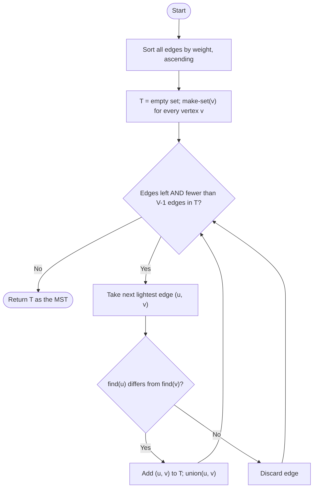
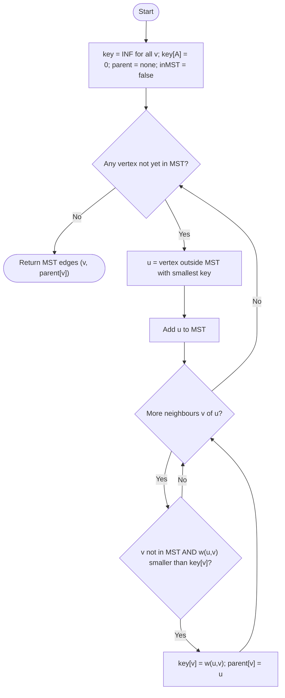

<div dir="rtl">

# درخت پوشای کمینه: کروسکال در برابر پریم

**گراف:** V = {A, B, C, D, E, F}

**یال‌ها (۱۰ یال):** AB=2, AC=2, BC=4, AE=6, BD=3, BE=4, DE=2, CF=3, CE=4, EF=2


## ۱. نمایش گراف


</div>

```
                    A
                  / | \
                2   |   2
              /     |     \
            /       6       \
          /         |         \
        B-----4-----+-----------C
      /   \         |         /   \
    3       \       |       /       3
  /           4     |     4           \
/               \   |   /               \
D---------2---------E---------2---------F
```

<div dir="rtl">


## ۲. الگوریتم کروسکال

### فلوچارت

</div>



<div dir="rtl">

### Trace

فهرست مرتب‌شده‌ی یال‌ها (در تساوی، ترتیب الفبایی):

`AB2, AC2, DE2, EF2 | BD3, CF3 | BC4, BE4, CE4 | AE6`

مجموعه‌های اولیه: {A} {B} {C} {D} {E} {F}

| تکرار | یال (وزن) | مجموعه‌ی u / v | تصمیم | مؤلفه‌ها پس از آن | هزینه تا اینجا |
|-------|-----------|----------------|-------|--------------------|-----------------|
| ۱ | AB (2) | {A} / {B} | پذیرش | {A,B} {C} {D} {E} {F} | 2 |
| ۲ | AC (2) | {A,B} / {C} | پذیرش | {A,B,C} {D} {E} {F} | 4 |
| ۳ | DE (2) | {D} / {E} | پذیرش | {A,B,C} {D,E} {F} | 6 |
| ۴ | EF (2) | {D,E} / {F} | پذیرش | {A,B,C} {D,E,F} | 8 |
| ۵ | BD (3) | {A,B,C} / {D,E,F} | پذیرش | {A,B,C,D,E,F} | 11 |

پس از تکرار 5، تعداد یال‌های T برابر 5 = V-1 است و حلقه متوقف می‌شود. یال‌های باقی‌مانده (CF، BC، BE، CE، AE) اصلاً بررسی نمی‌شوند. همه‌ی آن‌ها به دلیل ایجاد دور رد می‌شوند.

**یال‌های MST:** AB، AC، DE، EF، BD. **مجموع وزن = 11**

### تعداد تکرار بیرونی‌ترین حلقه

بیرونی‌ترین حلقه `for each edge in sorted order` است.
- **در این گراف (با خروج زودهنگام پس از V-1 یال): ۵ تکرار**، که همه پذیرفته شدند و هیچ‌کدام رد نشد.
- بدون خروج زودهنگام یا در بدترین حالت: E = 10 تکرار.

---

## ۳. الگوریتم پریم (شروع از رأس A)

### فلوچارت

</div>



<div dir="rtl">

### لیست مجاورت

- A: B(2), C(2), E(6)
- B: A(2), C(4), D(3), E(4)
- C: A(2), B(4), E(4), F(3)
- D: B(3), E(2)
- E: A(6), B(4), C(4), D(2), F(2)
- F: C(3), E(2)

### Trace

شروع: key = [A:0, B:∞, C:∞, D:∞, E:∞, F:∞]. همه‌ی parent‌ها خالی‌اند.

| تکرار | رأس انتخابی u (key) | یال افزوده‌شده | بروزرسانی (Relaxation) | key‌ها پس از آن (رأس‌های خارج از درخت) | هزینه تا اینجا |
|-------|----------------------|-----------------|-------------------------|-----------------------------------------|-----------------|
| ۱ | A (0) | هیچ (شروع) | B: ∞→2 (A)، C: ∞→2 (A)، E: ∞→6 (A) | B=2, C=2, D=∞, E=6, F=∞ | 0 |
| ۲ | B (2) | AB (2) | C: عدد 4 کمتر از 2 نیست، تغییری نمی‌کند. D: ∞→3 (B). E: 6→4 (B) | C=2, D=3, E=4, F=∞ | 2 |
| ۳ | C (2) | AC (2) | E: عدد 4 کمتر از 4 نیست، تغییری نمی‌کند. F: ∞→3 (C) | D=3, E=4, F=3 | 4 |
| ۴ | D (3) | BD (3) | E: 4→2 (D) | E=2, F=3 | 7 |
| ۵ | E (2) | DE (2) | F: 3→2 (E). A، B، C و D قبلاً در درخت هستند | F=2 | 9 |
| ۶ | F (2) | EF (2) | C و E قبلاً در درخت هستند | (چیزی باقی نمانده) | 11 |

تصمیم در تساوی (ترتیب الفبایی): در تکرار ۲، B بر C ترجیح داده شد (هر دو key برابر 2). در تکرار ۴، D بر F ترجیح داده شد (هر دو 3).

**یال‌های MST:** AB، AC، BD، DE، EF. **مجموع وزن = 11**

این همان درخت کروسکال است. البته MST یکتا نیست: یال CF می‌تواند جای BD بنشیند (هر دو وزن 3 دارند) و مجموع باز هم 11 می‌ماند. با ترتیب متفاوت در تساوی‌ها این حالت به دست می‌آید.

### تعداد تکرار بیرونی‌ترین حلقه

بیرونی‌ترین حلقه `while (some vertex is not in the MST)` است.
- **۶ تکرار** = V. تکرار اول فقط رأس شروع را بیرون می‌کشد و یالی اضافه نمی‌کند، بنابراین ۵ یال در تکرارهای ۲ تا ۶ اضافه می‌شود.
- اگر رأس شروع پیش از حلقه به درخت اضافه شود، حلقه V-1 = 5 بار اجرا می‌شود.

---

## ۴. پیچیدگی زمانی

V = تعداد رأس‌ها، E = تعداد یال‌ها. در این گراف V = 6 و E = 10.

| الگوریتم | Big-O (بدترین حالت) | Big-Θ | Big-Ω (بهترین حالت) |
|----------|----------------------|-------|----------------------|
| **کروسکال** (مرتب‌سازی مقایسه‌ای + union-find) | O(E log E) = O(E log V) | Θ(E log E) | Ω(E log E) |
| **پریم**، نسخه‌ی آرایه‌ای (جست‌وجوی خطی کمینه، مطابق ردگیری بالا) | O(V²) | Θ(V²) | Ω(V²) |
| **پریم**، با هیپ دودویی + لیست مجاورت | O(E log V) | Θ(E log V) در بدترین حالت | Ω(E + V log V) |

دلیل:
- **کروسکال:** مرتب‌سازی کامل با روش مقایسه‌ای مثل merge sort همیشه Θ(E log E) هزینه دارد. حلقه با union-find (فشرده‌سازی مسیر و union by rank) حداکثر E · α(V) اضافه می‌کند که تقریباً خطی است. چون E ≤ V²، داریم log E ≤ 2 log V، پس E log E و E log V هم‌مرتبه‌اند. خروج زودهنگام فقط از کار حلقه کم می‌کند و مرتب‌سازی را کم نمی‌کند، پس بهترین و بدترین حالت یکی است.
- **پریم (آرایه‌ای):** هر یک از V تکرار، همه‌ی V مقدار key را برای یافتن کمینه پیمایش می‌کند و بروزرسانی همسایه‌ها در مجموع O(V) یا O(E) است. نتیجه V · V = Θ(V²) و مستقل از ورودی است، پس O و Θ و Ω یکی‌اند.
- **پریم (هیپ):** V بار extract-min هزینه‌ی V log V دارد و هر یال یک‌بار دیده می‌شود (Ω(E + V log V)). در بدترین حالت هر یال یک بروزرسانی هیپ به هزینه‌ی log V ایجاد می‌کند که O(E log V) می‌دهد. برای این نسخه یک Θ واحد که روی همه‌ی ورودی‌ها صدق کند وجود ندارد.
- **کدام بهتر است:** کروسکال و پریم با هیپ برای گراف‌های خلوت مناسب‌ترند، و پریم آرایه‌ای برای گراف‌های متراکم (E نزدیک V²).

</div>
